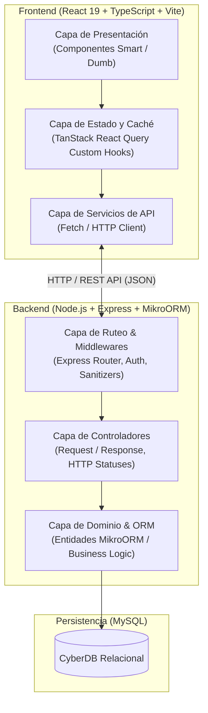
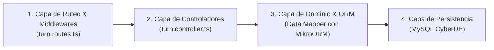
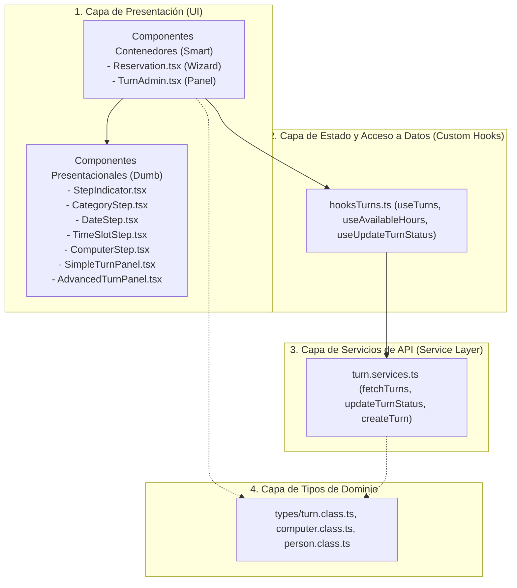

# Documentación de Arquitectura: CyberCafé Player Start
> **Materia:** Desarrollo de Software (DSW) — UTN FRRo  
> **Proyecto:** Sistema de Gestión y Reserva de Turnos para Cibercafé  
> **Integrantes:** Figoni, Matías | Díaz, Marcio | Mascheroni, Lucas

---

## 🏛️ 1. Visión General de la Arquitectura

El sistema implementa una **Arquitectura Cliente-Servidor Desacoplada (Decoupled Full-Stack Architecture)**. El Frontend (Single Page Application en React) y el Backend (RESTful API en Express) son totalmente **agnósticos** entre sí y se comunican exclusivamente a través del protocolo HTTP intercambiando payloads en formato JSON.



---

## ⚙️ 2. Arquitectura del Backend: Arquitectura en Capas (Layered Architecture)

El backend sigue estrictamente el requisito de la cátedra de **desarrollo mediante capas**:



### Capa 1: Ruteo y Middlewares (Cross-Cutting Concerns)
- **Archivos:** `turn.routes.ts`, `computer.routes.ts`, `AdminMiddleware.ts`, `middlewareWeUsing.ts`.
- **Responsabilidad:**
  - Definir las rutas HTTP y verbos (`GET`, `POST`, `PATCH`, `DELETE`).
  - Interceptar y sanitizar datos de entrada (`sanitizeTurnInput`).
  - Control de accesos y roles (`requireAdmin`).
  - Inyectar el `RequestContext` de MikroORM por cada petición para garantizar aislamiento de transacciones.

### Capa 2: Controladores (Application Orchestration Layer)
- **Archivos:** `turn.controller.ts`, `computer.controler.ts`, `client.controler.ts`.
- **Responsabilidad:**
  - Extraer parámetros de la URL, query strings y body.
  - Ejecutar validaciones de formato y reglas de negocio inmediatas (lunes cerrado, horarios válidos de 8 a 24).
  - Responder con los códigos de estado HTTP semánticos correctos:
    - `200 OK`: Consulta o actualización exitosa.
    - `201 Created`: Turno registrado con éxito.
    - `400 Bad Request`: Formato inválido o local cerrado.
    - `404 Not Found`: Entidad no encontrada.
    - `409 Conflict`: Turno duplicado o máquina ya ocupada.
    - `500 Internal Server Error`: Errores no controlados.

### Capa 3: Dominio y Persistencia (Data Mapper Pattern con MikroORM)
- **Archivos:** `turn.entity.ts`, `computer.entity.ts`, `client.entity.ts`, `category.entity.ts`, `pay.entity.ts`.
- **Responsabilidad:**
  - Mapear las tablas relacionales a clases POO con decoradores (`@Entity()`, `@Property()`, `@ManyToOne()`, `@OneToMany()`).
  - Aislar la base de datos de las entidades mediante el **Entity Manager** (`orm.em.fork()`), implementando el patrón **Unit of Work** y **Identity Map**.

---

## 🎨 3. Arquitectura del Frontend: Component-Driven Architecture + Service Layer

El frontend implementa una separación por responsabilidades en 4 niveles:



### 1. Componentes Contenedores (Smart) vs. Presentacionales (Dumb)
- **Smart (`Reservation.tsx`, `TurnAdmin.tsx`):** Manejan el estado global de la página, consumen los custom hooks, manejan errores y transiciones entre pasos.
- **Dumb (`StepIndicator.tsx`, `SimpleTurnPanel.tsx`, `DateStep.tsx`):** Componentes puros y desacoplados. Reciben datos mediante `props` y emiten eventos (`onClick`, `onChange`).

### 2. Capa de Servicios de API (`services/`)
- Desacopla la vista de la red. Si el backend cambia una URL o endpoint, **solo se modifica el service**, los componentes no sufren alteraciones.

### 3. Capa de Caché y Reactividad (`hooks/` + TanStack React Query)
- Implementa el patrón **Observer / Cache-aside**:
  - Al realizar un **Check-in**, `useUpdateTurnStatus` ejecuta `queryClient.invalidateQueries({ queryKey: ['turns-all'] })`.
  - Esto actualiza instantáneamente todas las vistas sin necesidad de recargar la página.

---

## 🧩 4. Patrones de Diseño Aplicados (Para la Defensa Oral)

| Patrón | Dónde se aplica | Justificación técnica |
|---|---|---|
| **Data Mapper (ORM)** | Backend (MikroORM) | Separa el modelo de datos en memoria de la base de datos MySQL relacional. |
| **Unit of Work** | Backend (`orm.em.flush()`) | Mantiene una lista de objetos afectados por una transacción de negocio y escribe los cambios de forma atómica. |
| **Wizard / Finite State Machine (FSM)** | Frontend (`Reservation.tsx`) | El usuario avanza secuencialmente por estados discretos (1. Categoría → 2. Fecha → 3. Horario → 4. PC). No se puede saltar al paso siguiente sin satisfacer las invariantes del paso actual. |
| **Strategy Pattern / Multi-View Strategy** | Frontend (`TurnAdmin.tsx`) | Permite alternar en tiempo de ejecución entre dos estrategias de visualización: la estrategia de mostrador rápido (`SimpleTurnPanel`) y la de análisis histórico (`AdvancedTurnPanel`). |
| **Observer / Pub-Sub** | Frontend (TanStack Query + Context API) | Notifica a los componentes cuando las reservas cambian de estado o se invalidan cachés. |
| **Facade / Service Layer** | Frontend (`turn.services.ts`) | Ofrece una interfaz unificada y simplificada sobre las llamadas HTTP a la API. |
| **Identity Map** | Backend (MikroORM) | Garantiza que cada objeto de base de datos se cargue solo una vez por petición dentro del `RequestContext`. |

---

## 🔄 5. Diagrama de Secuencia: Flujo de Check-in (CUU/Epic)

```mermaid
sequenceDiagram
    autonumber
    actor Admin as Administrador
    participant UI as SimpleTurnPanel (React)
    participant Hook as useUpdateTurnStatus (React Query)
    participant Service as turn.services.ts
    participant Router as turn.routes.ts (Express)
    participant Controller as turn.controller.ts
    participant ORM as MikroORM (Unit of Work)
    participant DB as MySQL (CyberDB)

    Admin->>UI: Clic en "[ Check-in ]"
    UI->>Hook: mutate({ id: 12, status: 'INICIADO' })
    Hook->>Service: updateTurnStatus(12, 'INICIADO')
    Service->>Router: PATCH /api/turns/12 { status: 'INICIADO' }
    Router->>Controller: updateTurn(req, res)
    Controller->>ORM: findOne(Turn, { id: 12 })
    ORM->>DB: SELECT * FROM turn WHERE id = 12
    DB-->>ORM: Datos del turno
    ORM-->>Controller: Instancia de Turn
    Controller->>ORM: turn.status = 'INICIADO'; em.flush()
    ORM->>DB: UPDATE turn SET status = 'INICIADO' WHERE id = 12
    DB-->>ORM: OK (1 row affected)
    Controller-->>Service: 200 OK { message: 'Turno actualizado', data: turn }
    Service-->>Hook: Retorna turno actualizado
    Hook->>Hook: Invalida queries ['turns-all', 'available-computers']
    Hook-->>UI: Actualiza UI en tiempo real
    UI-->>Admin: Muestra badge "INICIADO" y botón "Finalizar Turno"
```

---

## 🎤 6. Guía de Preguntas Típicas para la Defensa Oral

### Pregunta 1: *"¿Por qué la arquitectura es agnóstica entre Frontend y Backend?"*
> **Respuesta:** *"Porque el backend no renderiza vistas ni depende de React; solo expone una API REST stateless que responde en JSON. Esto nos permitiría reemplazar el frontend por una aplicación móvil en React Native o Flutter sin cambiar una sola línea de código en el backend."*

### Pregunta 2: *"¿Cómo manejan la concurrencia para evitar que dos personas reserven la misma máquina al mismo tiempo?"*
> **Respuesta:** *"En el backend, dentro de `turn.controller.ts`, antes de persistir cualquier turno verificamos si existe un turno solapado en fecha y rango horario para esa misma computadora con estado `PENDIENTE`, `RESERVADO` o `INICIADO`. Si existe solapamiento, la API rechaza la petición con código HTTP `409 Conflict`."*

### Pregunta 3: *"¿Qué patrón usaron para la persistencia y por qué?"*
> **Respuesta:** *"Utilizamos el patrón **Data Mapper** a través de **MikroORM**. A diferencia de Active Record donde las entidades conocen cómo guardar datos, en Data Mapper las entidades son clases de dominio puras y el `EntityManager` se encarga de la persistencia y de aplicar el patrón **Unit of Work** mediante `flush()`."*

### Pregunta 4: *"¿Cómo implementaron el caso de uso de Check-in?"*
> **Respuesta:** *"El empleado/admin accede a la vista de mostrador en `/admin/TurnAdmin`. El sistema muestra las reservas del día ordenadas cronológicamente. Al hacer clic en 'Check-in', se envía una mutación PATCH que actualiza el estado a `INICIADO`. Nuestro backend protege la disponibilidad reconociendo que una máquina con estado `INICIADO` continúa ocupada."*


### Pregunta 5: *"¿Qué reglas de negocio aplican al Check-in en el mostrador?"*
> **Respuesta:** *"Implementamos validaciones tanto en frontend como en backend:
> 1. **Ventana de vigencia:** No se permite realizar check-in de turnos con más de un día de antigüedad (`now - startTime > 24hs`), ya que carece de sentido operativo iniciar una reserva expirada.
> 2. **Validación de identidad y cobro:** En la vista rápida de mostrador, cada turno cuenta con un panel desplegable de validación para cotejar el DNI y teléfono del cliente presencial y verificar si el turno cuenta con pagos registrados o requiere cobro en mostrador antes de iniciar la sesión."*
